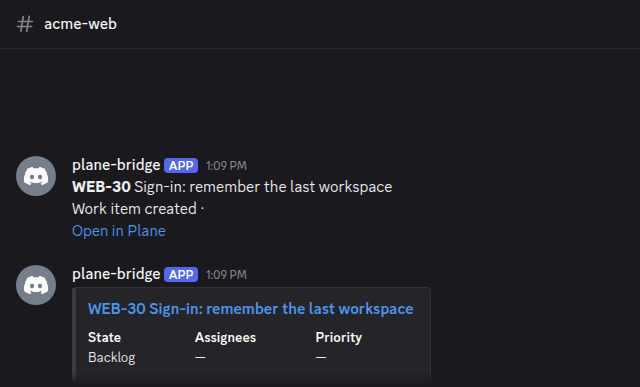
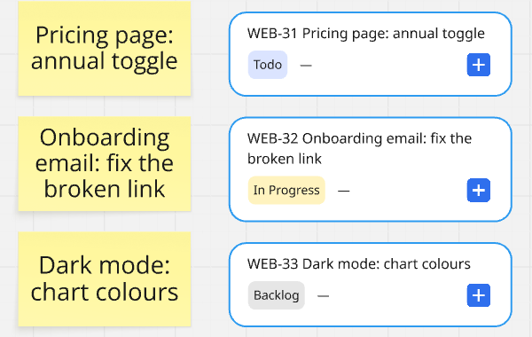
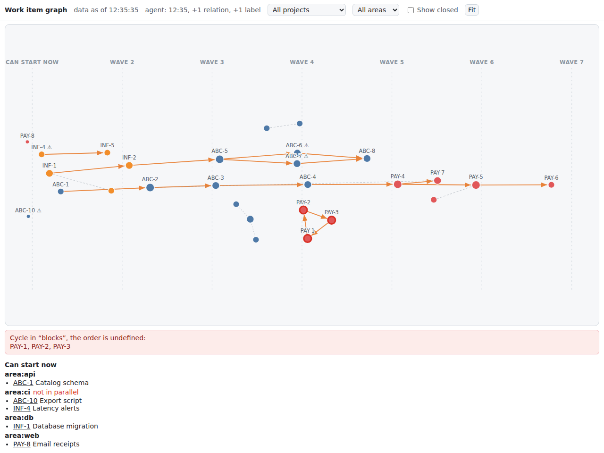

# plane-bridge

Self-hosted integrations that connect a Plane workspace to GitHub, Grafana, Discord and Miro, and draw the order its work can be done in.

plane-bridge is a community project. It is not affiliated with, endorsed by or supported by Plane Software, Inc.

## Integrations

### plane-hooks


- Moves a work item along by the facts of its pull requests and deploys (GitHub, Vercel, Dokploy): ready for review, merged, deployed.
- Opens incidents in a Plane project from Grafana alerts and from failed deploys, builds and backups.
- Comments the preview link of a Vercel preview on the work item.

[README](apps/plane-hooks/README.md) · [Install checklist](apps/plane-hooks/README.md#install-checklist)

### plane-discord



- Sends Plane events (a work item created or closed, an assignment, a mention) to Discord channels and DMs.
- Turns a Discord message into a work item, or into a comment on one.
- `/plane KEY` answers in the channel with a card of the work item.

[README](apps/plane-discord/README.md) · [Install checklist](apps/plane-discord/README.md#install-checklist)

### plane-miro



- Turns the stickers of a Miro board into Plane work items, with a card of the work item next to each one.
- Shows the status of a work item on its cards, on every board that has one.
- A Miro link in a Plane comment puts the work item's card on that board.

[README](apps/plane-miro/README.md) · [Install checklist](apps/plane-miro/README.md#install-checklist)

### plane-graph



- Draws the order the work can be done in: work items joined by "blocks" in waves, where wave 0 can start now.
- Reports cycles, and flags tasks of one wave that share an area label as not parallel.
- Gives your own agent the data and a place to report back: `GET /t/<tenant>/snapshot.json` reads the graph, `POST /t/<tenant>/agent-runs` reports the relations and labels the agent added.

[README](apps/plane-graph/README.md) · [Install checklist](apps/plane-graph/README.md#install-checklist)

## Plane editions

| Plane                                               | Supported                |
| --------------------------------------------------- | ------------------------ |
| Plane Cloud                                         | yes                      |
| Commercial Edition, self-hosted, Free plan included | yes                      |
| Community Edition                                   | no: it has no Plane Apps |

The Plane Cloud Free plan is not checked yet. Versions and dates are in the Compatibility section of each app, for
example [plane-hooks](apps/plane-hooks/README.md#compatibility).

## Install

1. Register the app in Plane. On Plane Cloud: Workspace settings → Integrations → Apps → Build your own.
2. Write `tenants.json`.
3. Set the environment variables.
4. Run the image `ghcr.io/alxwlw/plane-<app>:0.1`.

Each app's Install checklist has the exact order, values and final check:
[plane-hooks](apps/plane-hooks/README.md#install-checklist),
[plane-discord](apps/plane-discord/README.md#install-checklist),
[plane-miro](apps/plane-miro/README.md#install-checklist),
[plane-graph](apps/plane-graph/README.md#install-checklist).

## Packages

- [`packages/plane-app`](packages/plane-app) — shared Plane App code: bot-token auth (`botTokenAuth`) and the
  install redirect and callback (`planeSetupRedirect`, `planeOauthCallback`).
- [`packages/plane-kit`](packages/plane-kit) — modules the Plane apps share: `html`, `queue`, `rate`, `ttl`, `log`
  and `capture` (the request-capture script behind each app's `scripts/capture.ts`), `locale` (the tenant
  languages) and `links` (work item URLs), plus `testing` (test-only helpers for the apps' guard tests).
- [`packages/release`](packages/release) — the release tool: which app versions to release, their tags and notes;
  see [RELEASING.md](RELEASING.md). Each app keeps a `CHANGELOG.md` next to its `package.json`.

## Development

A pnpm + moon monorepo on the [`@alxwlw/stack`](https://github.com/alxwlw/stack) toolchain canon.

```bash
pnpm install
pnpm exec moon run :lint :format :typecheck :test
pnpm exec stack check
```

## License

[MIT](LICENSE)
