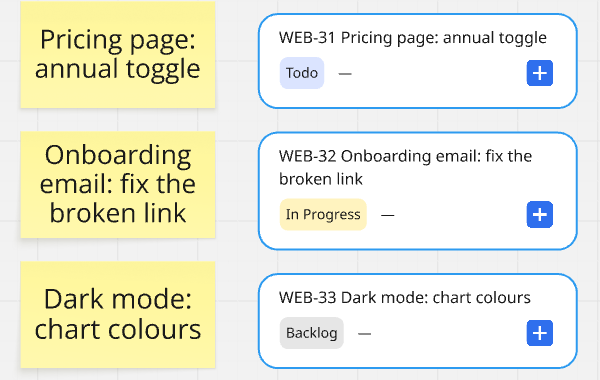

# plane-miro



A [Bun](https://bun.sh) service that links [Plane](https://plane.so) and [Miro](https://miro.com) for one or
more tenants (a Plane workspace plus a Miro team each). It has no third-party runtime dependencies (it uses the workspace packages `@alxwlw/plane-app` and `@alxwlw/plane-kit`, which the image carries as source), keeps its state in one
SQLite file and serves its own front end: `web/*.ts` is bundled by `Bun.build` at start.

What it does:

- **Stickers become work items.** In the Miro panel the user picks a Plane project and presses "To Plane": each
  selected sticker (also a card, a shape or a text) becomes a work item with `external_source=miro` and
  `external_id=<board>:<item>`, and a card of the work item appears next to it. A second press on the same
  sticker creates nothing new, and a conversion cut short is finished by the repeat.
- **A work item points to its place on the board.** The work item gets a link
  `https://miro.com/app/board/<board>/?moveToWidget=<card>`; a tenant with `embed: true` also gets an Embed block
  of that place in its description.
- **Status on the cards.** A change of state, title or assignees in Plane updates the cards of the work item on
  every board; a deleted work item turns its cards `disabled`. A card deleted by hand on the board is forgotten.
- **A Miro link in a comment or in "Links"** puts the work item's card on that board, if the board belongs to the
  tenant's Miro team; a board of another team gets nothing (`link.board_other_team` in the log).

A sticker can also be bound to an existing work item (search by key or text) instead of creating one.
Everything that changes the board is done by the service through the Miro REST API with the token of one
service account; the front only reads the selection and calls the service with the user's id token.

Hidden projects (`hiddenProjects`) are hidden completely: not offered, not found, never synced; a sticker converted
before its project was hidden is refused (`unknown_project`).

## Compatibility

plane-miro is a Plane App (OAuth, a bot token per workspace, signed webhooks). Plane Apps exist in Plane Cloud and in
the self-hosted Commercial Edition, its Free plan included. The open-source Community Edition (`makeplane/plane`)
has none, so plane-miro cannot run against it. Check a self-hosted instance with
`curl https://plane.example.com/api/instances/`: its `edition` must be `PLANE_COMMERCIAL`.

| Plane                                               | Supported | Checked on                                       |
| --------------------------------------------------- | --------- | ------------------------------------------------ |
| Plane Cloud                                         | yes       | 2026-11-23, a workspace on a Business-plan trial |
| Commercial Edition, self-hosted, Free plan included | yes       | v4.1.0                                           |
| Community Edition                                   | no        | —                                                |

Plane Cloud publishes no version number. The Cloud Free plan was not checked. The Cloud check ran the app's install and
its minimal scenario with the 0.1.0 release candidates, whose code 0.1.0 ships unchanged. The Commercial Edition version is
the one the maintainer's own installations run every day.

## Install checklist

Do the steps in this order. The service does not start without the Miro app's client id and secret, so the Miro app
(and the developer team it lives in) comes first; the Plane installation id exists only after the consent, so the
first `tenants.json` carries a placeholder for it (and for the workspace UUID, which step 7 reads from the log, and
for the Miro team id, which step 6 reads from the log of the Miro app's install); and boards change only after one
Miro account is connected (step 9). Below, `acme` is the tenant id, `example-ws` the Plane workspace slug.

1. **Register the Plane App** ([Plane App](#plane-app) below) with the service's URLs and **Enable App Mentions** off.
   In the form's Webhook Secret put a secret from `openssl rand -hex 32` and keep it for
   `PLANE_MIRO_ACME_WEBHOOK_SECRET`: the service requires it, separate from the client secret. Tick the scope grid.
   Copy the **Client ID** and the **Client Secret** at once: the Secret is shown only in the "App created" dialog.
2. **Create a Miro developer team** if you have none (Miro asks you to accept the Developer Terms), then **the Miro
   app** in it ([Miro app](#miro-app) below): App URL, redirect URI, scopes, «Expire user authorization token» off.
   Upload both icons (an outline SVG and a colour SVG; any pair will do): Miro wants them before the app shows in
   a board's apps panel. Copy the app's **Client ID** and **Client Secret**.
3. **Write a first `tenants.json`** in `config/` (`mkdir config && $EDITOR config/tenants.json`). Replace every
   value; `tenants.example.json` stays the full reference. `workspaceId`, `appInstallationId` and `miro.teamId` are
   placeholders until steps 5 to 7:

   ```json
   {
   	"tenants": [
   		{
   			"id": "acme",
   			"workspace": "example-ws",
   			"workspaceId": "00000000-0000-0000-0000-000000000000",
   			"plane": { "clientId": "<Client ID from step 1>", "appInstallationId": "placeholder" },
   			"miro": { "teamId": "1" },
   			"embed": true
   		}
   	]
   }
   ```

   Where each value comes from:
   - `workspace`: the slug in the Plane URL (`https://app.plane.so/<slug>/…`).
   - `plane.clientId`: step 1. `appInstallationId`: step 5, `workspaceId`: step 7 (the placeholders stay until then).
   - `miro.teamId`: digits only. The Miro documentation names no page that shows a team's id, so start with the
     placeholder `1`: step 6 logs the id of the team the app was installed in (`miro.installed`, its `team`
     field).
   - The Miro app's client id and secret go to the environment, not to this file: step 2.

4. **Start the service** with the Plane Cloud API address, the public URL and the secrets of steps 1 and 2. The
   public URL must be reachable over HTTPS from Miro and from Plane (a TLS reverse proxy in front of port 8080).
   The `tenants.json` is read only at start: any change to it, like a change of env, needs
   `docker rm -f plane-miro` and the command again.

   ```bash
   docker run -d --name plane-miro --restart unless-stopped \
     -p 8080:8080 \
     -v plane-miro-data:/data \
     -v "$PWD/config:/config:ro" \
     -e PLANE_MIRO_PLANE_URL=https://api.plane.so \
     -e PLANE_MIRO_PLANE_WEB_URL=https://app.plane.so \
     -e PLANE_MIRO_PUBLIC_URL=https://plane-miro.example.com \
     -e PLANE_MIRO_MIRO_CLIENT_ID='<Client ID of the Miro app from step 2>' \
     -e PLANE_MIRO_MIRO_CLIENT_SECRET='<Client Secret of the Miro app from step 2>' \
     -e PLANE_MIRO_ACME_PLANE_SECRET='<Client Secret of the Plane App from step 1>' \
     -e PLANE_MIRO_ACME_WEBHOOK_SECRET='<the Webhook Secret from step 1>' \
     ghcr.io/alxwlw/plane-miro:0.1
   ```

   The same as a compose service (the secrets come from the shell or an `.env` file next to it):

   ```yaml
   services:
     plane-miro:
       image: ghcr.io/alxwlw/plane-miro:0.1
       container_name: plane-miro
       restart: unless-stopped
       ports: ['8080:8080']
       volumes:
         - plane-miro-data:/data
         - ./config:/config:ro
       environment:
         PLANE_MIRO_PLANE_URL: https://api.plane.so
         PLANE_MIRO_PLANE_WEB_URL: https://app.plane.so
         PLANE_MIRO_PUBLIC_URL: https://plane-miro.example.com
         PLANE_MIRO_MIRO_CLIENT_ID: ${PLANE_MIRO_MIRO_CLIENT_ID}
         PLANE_MIRO_MIRO_CLIENT_SECRET: ${PLANE_MIRO_MIRO_CLIENT_SECRET}
         PLANE_MIRO_ACME_PLANE_SECRET: ${PLANE_MIRO_ACME_PLANE_SECRET}
         PLANE_MIRO_ACME_WEBHOOK_SECRET: ${PLANE_MIRO_ACME_WEBHOOK_SECRET}
   volumes:
     plane-miro-data:
   ```

   `container_name` keeps the commands below (`docker logs`, `docker rm -f`) the same for both ways. With compose,
   a change of `tenants.json` needs `docker compose restart plane-miro`; a change of env needs
   `docker compose up -d --force-recreate plane-miro`.

   You see the `listening` line with `"id":"acme"` in `docker logs plane-miro`, and
   `curl https://plane-miro.example.com/healthz` answers `ok`. All variables are in
   [Configuration](#configuration); a wrong value stops the start with one message that names it.

5. **Open `https://plane-miro.example.com/plane/setup?tenant=acme`** in a browser logged in to Plane as a workspace
   admin. It redirects to the Plane consent screen. Plane's consent screen says the app "hasn't been reviewed or
   approved by Plane"; every private app shows it, so approve it. You land on a plain-text page that prints
   `app_installation_id=<uuid>`.
6. **Install the Miro app** in the team with the install link of the app settings: Miro asks you to **Select an
   organization** (and the team), then to install. The install carries no tenant, so the service only logs it:
   `docker logs plane-miro` shows a line with `"event":"miro.installed"` and `"team":"<id>"`, the Miro team id.
7. **Find the workspace UUID.** Plane Cloud shows the workspace UUID nowhere in its pages, but the service logs it:
   make any change in Plane (create a work item). On a new Plane Cloud workspace a product tour pops up over the
   work-item dialog the first time: close it. The service does not know the workspace yet, so
   `docker logs plane-miro` shows a line with `"event":"plane.rejected"`, `"reason":"unknown_workspace"` and
   `"workspaceId":"<uuid>"`. (Plane's API gives it too: `GET https://api.plane.so/auth/o/app-installation/?id=<installation id>`
   with the bot token answers `"workspace": "<uuid>"`; see
   [Plane's token flow](https://developers.plane.so/dev-tools/build-plane-app/choose-token-flow).)
8. **Put the ids in and restart once.** Put the team id of step 6 in `miro.teamId`, the UUID of step 7 in
   `workspaceId` and the id printed in step 5 in `plane.appInstallationId`, then **restart** the container
   (`docker rm -f plane-miro` and the command of step 4). The `listening` line appears again and `/healthz`
   answers `ok`.
9. **Connect the service account** ([Connecting the service account](#connecting-the-service-account)): one Miro
   account of the team opens `https://plane-miro.example.com/miro/setup?tenant=acme` and grants access. The log
   shows `miro.service_connected`. A token of another team than `miro.teamId` is refused with `miro.wrong_team`
   and `"team":"<id>"`, the id the token belongs to: put that id in `miro.teamId`, restart as in step 8 and open
   the link again.
10. **Check.** The minimal scenario: a sticky becomes a work item, and its state shows on the card.
    - On a board of the team open the app from the apps panel, pick the Plane project and turn a sticky into a work
      item with **To Plane**: the work item exists in Plane with the link to the board (and the embed).
    - Change its state in Plane (close the product tour, as in step 7): the card on the board shows the new state
      within seconds, and the log shows `plane.accepted`.

## Routes

| Path                                                                | Purpose                                                                                     |
| ------------------------------------------------------------------- | ------------------------------------------------------------------------------------------- |
| `POST /plane/webhook`                                               | Plane App webhook, signed with the app's webhook secret                                     |
| `GET /plane/setup`                                                  | `?tenant=<id>`: redirects to the Plane consent screen of the app                            |
| `GET /plane/oauth/callback`                                         | Prints the `app_installation_id` for `tenants.json`                                         |
| `GET /miro/setup`                                                   | `?tenant=<id>`: the link that connects the service account to Miro                          |
| `GET /miro/oauth/callback`                                          | Miro OAuth redirect; stores the service account's token                                     |
| `GET /miro/app`, `/miro/panel`, `/miro/card`, `/miro/assets/<n>.js` | The pages and bundles Miro loads (`frame-ancestors https://miro.com`)                       |
| `GET /miro/api/projects`, `/search`, `/card`                        | The front's API (read)                                                                      |
| `GET /miro/api/locale`                                              | The tenant's language for the panel and the card viewer, from the Miro team of the id token |
| `POST /miro/api/convert`, `/bind`                                   | The front's API (write); may run for minutes under the Plane limits                         |
| `GET /healthz`                                                      | `ok`                                                                                        |

The API accepts only `Authorization: Bearer <id token>` (`miro.board.getIdToken()`), checks it against the
Miro app's client secret and serves the tenant of the token's team. `POST /plane/webhook` always answers `200`,
accepted or not: a non-2xx counts as a failure at Plane, and after five of them Plane disables the webhook. What
cannot be accepted (bad signature, unknown workspace, broken JSON, a body over 4 MiB) is logged with
`level: "error"` and `event: "plane.rejected"`.

## Watchdog

Every 15 minutes, for each tenant (a failure of one never stops the others), log lines only:

- **Plane silence.** No delivery for longer than `silenceHours` (counted from the start for a tenant that never
  had one) logs `plane.silent` at `error` once; the first delivery after that logs `plane.alive`. Plane does not
  show a webhook's status to a bot token, so silence is all there is.
- **Miro token.** No token stored: `miro.not_connected` (`error`) on the first check and on every change of
  state. The token rejected by Miro: `miro.token_invalid` (`error`) once; valid again: `miro.token_ok`. A network
  error is `watchdog.failed` and changes nothing.

Once a day the deduplication keys older than 30 days are deleted.

## Configuration

Environment:

| Variable                         | Required | Meaning                                                                                                      |
| -------------------------------- | -------- | ------------------------------------------------------------------------------------------------------------ |
| `PLANE_MIRO_PLANE_URL`           | yes      | Plane API base URL, e.g. `https://plane.example.com`; on Plane Cloud `https://api.plane.so`                  |
| `PLANE_MIRO_PLANE_WEB_URL`       | no       | Plane web address for work-item links; default `PLANE_MIRO_PLANE_URL`; on Plane Cloud `https://app.plane.so` |
| `PLANE_MIRO_PUBLIC_URL`          | yes      | Public URL of this service, e.g. `https://plane-miro.example.com`                                            |
| `PLANE_MIRO_MIRO_CLIENT_ID`      | yes      | Client id of the Miro app                                                                                    |
| `PLANE_MIRO_MIRO_CLIENT_SECRET`  | yes      | Client secret of the Miro app (also signs the id tokens)                                                     |
| `PLANE_MIRO_<ID>_PLANE_SECRET`   | yes      | Per tenant: client secret of the Plane App                                                                   |
| `PLANE_MIRO_<ID>_WEBHOOK_SECRET` | yes      | Per tenant: webhook secret of the Plane App                                                                  |
| `PLANE_MIRO_CONFIG`              | no       | Tenants file, default `/config/tenants.json`                                                                 |
| `PLANE_MIRO_DB`                  | no       | SQLite file, default `/data/plane-miro.sqlite`                                                               |
| `PORT`                           | no       | Listen port, default `8080`                                                                                  |

`<ID>` is the tenant id in upper case. A missing or malformed value stops the start with one message listing
every problem; the message names variables and JSON paths, never values. A failed build of `web/` stops it too.

Tenants: [`tenants.example.json`](tenants.example.json) shows every key (tenant id, Plane workspace and its UUID,
the Plane App's client id and installation id, the Miro team id, `embed`, `keepSource`, `silenceHours`, hidden
projects, `locale`). The tenant id matches `^[a-z][a-z0-9]{0,15}$`; the Plane workspace and the Miro team of two tenants
must differ. UUIDs may be written in any case: they are read in lower case, as Plane sends them.

`locale` is `en` (the default) or `ru`. Every text the app writes (Plane descriptions and comments, the panel, the card viewer and the OAuth replies) is in the tenant's language; logs, startup errors and the operator scripts are English. A request whose tenant is unknown is answered in English; the client pages learn the tenant's language from `GET /miro/api/locale`, so a `ru` tenant's card viewer shows the English `Loading…` for the moment before that answer. A change takes effect after a restart.

## Plane App

Register one app per Plane instance and install it in each workspace
([Plane docs: create an OAuth application](https://developers.plane.so/dev-tools/build-plane-app/create-oauth-application)).
On Plane Cloud the form opens directly at `https://app.plane.so/<workspace-slug>/settings/integrations/create/`
(`https://app.plane.so/example-ws/settings/integrations/create/` for the example workspace), titled "Build your own app".
On the Commercial Edition click through the sidebar instead: in Plane open **Workspace settings** and click
**Integrations** in the settings sidebar, then **Apps**, then the **Build your own** link. The form asks for these
fields, in this order (`*` is required on Plane Cloud):

| Field                              | Value                                                                                                                                                                                                                                 |
| ---------------------------------- | ------------------------------------------------------------------------------------------------------------------------------------------------------------------------------------------------------------------------------------- |
| Upload Logo                        | optional                                                                                                                                                                                                                              |
| App Name \*                        | anything, for example `plane-miro-acme`                                                                                                                                                                                               |
| App slug \*                        | for example `plane-miro-acme`                                                                                                                                                                                                         |
| App Maker \*                       | the person or organization creating the app, for example `acme`                                                                                                                                                                       |
| Short Description \*               | for example `Turns Miro stickers into Plane work items`                                                                                                                                                                               |
| Long Description \*                | a rich-text paragraph, for example the first paragraph of this README                                                                                                                                                                 |
| Website                            | optional                                                                                                                                                                                                                              |
| Connection Type                    | choose **Workspace-Level Connection** (Plane Cloud's form starts on User-Level Connection): the app is installed once per workspace and acts as a bot, not as a person. On the Commercial Edition leave **User-Level Connection** off |
| Enable App Mentions                | off                                                                                                                                                                                                                                   |
| Setup URL                          | `https://plane-miro.example.com/plane/setup?tenant=<id>`                                                                                                                                                                              |
| Webhook URL                        | `https://plane-miro.example.com/plane/webhook`                                                                                                                                                                                        |
| Webhook Secret                     | the form issues none: a secret of your own (`openssl rand -hex 32`), kept for `PLANE_MIRO_<ID>_WEBHOOK_SECRET`                                                                                                                        |
| Redirect URIs (space separated) \* | `https://plane-miro.example.com/plane/oauth/callback`                                                                                                                                                                                 |
| Scopes (**Scopes & Permissions**)  | the grid below                                                                                                                                                                                                                        |

The collapsed sections (Categorisation, Supported Plans, Compliance & Support, Additional resources) are all
optional: leave them as they are (Supported Plans: leave empty, which allows all plans).

The scopes are a grid with a Read and a Write column, not machine names: tick, per row, the cells below. The rows
are in the grid's **Projects** and **Workspaces** sections. Each of the 10 scope names the service requests is one
cell:

| Row in the grid    | Read | Write | Scope names                                             |
| ------------------ | ---- | ----- | ------------------------------------------------------- |
| Projects           | yes  | no    | `projects:read`                                         |
| Project Members    | yes  | no    | `projects.members:read`                                 |
| Project States     | yes  | no    | `projects.states:read`                                  |
| Work Items         | yes  | yes   | `projects.work_items:read`, `projects.work_items:write` |
| Work Item Comments | yes  | yes   | `projects.work_items.comments:read`, `…comments:write`  |
| Work Item Links    | yes  | yes   | `projects.work_items.links:read`, `…links:write`        |
| Workspace Members  | yes  | no    | `workspaces.members:read`                               |

Plane does not take the scopes from the registration, so the service sends them (space-separated) as the
`scope` parameter of the consent URL and of every token request.

Installing the app through the setup URL ends on the callback page, which prints
`app_installation_id=<uuid>`; put it in `tenants.json`.

The id exists only after that consent, but the service does not start without the key
(`plane.appInstallationId must be a non-empty string`), and `/plane/setup` uses only `plane.clientId`. So start with the
real `clientId` and `"appInstallationId": "placeholder"` (nothing checks the shape), run the setup URL, then replace the
placeholder with the printed id and restart the container.

## Miro app

Miro lets you create an app only in a developer team, so make that team first if you have none (Miro asks you to
accept the Developer Terms). Create the app in it:

- App URL (`sdkUri`) `https://plane-miro.example.com/miro/app`
- Redirect URI for OAuth2.0 `https://plane-miro.example.com/miro/oauth/callback`
- «Use this URI for SDK authorization» off
- Scopes `boards:read`, `boards:write`, `identity:read`
- «Expire user authorization token» **off**: the service keeps one token with no refresh, and the setting cannot
  be changed afterwards
- Upload both icons, an outline SVG and a colour SVG (any pair will do): Miro asks for them before the app shows in
  a board's apps panel

Install it in the team with the install link of the app settings; Marketplace is not needed. Miro asks you to
**Select an organization** (and the team) before it installs the app.

### Connecting the service account

Boards are changed with the token of one Miro account that is a member of the team. That account opens
`https://plane-miro.example.com/miro/setup?tenant=acme`, signs in and grants access; the callback stores its token
for the tenant's team (the `state` of the link is signed and expires). Installs by other people leave no token.
Until the account is connected the API answers that Miro is not connected and the watchdog logs
`miro.not_connected`. A board is available to the service when the account can see it.

## Operations

- **Logs** are one JSON line per event on stdout: `{ts, event, tenant?, …ids, ms?, error?}`. Secrets, tokens, id
  tokens and the text of stickers, work items and comments never reach them.
- **State** is one SQLite file (`/data`, a named volume): deduplication keys, links between stickers, work items
  and cards, the service account's token, the watchdog heartbeat. It is not backed up. Losing it costs the token
  (connect the account again), the card links (new events stop updating existing cards) and the deduplication
  window. Nothing in Plane or Miro is lost.
- **Queue** is in memory: a restart drops the Plane events not yet handled. A retryable failure (Miro or Plane
  429, 5xx, a dropped connection) is retried after 1 s, 5 s and 30 s.
- **Long calls.** `POST /miro/api/convert` and `/bind` can wait minutes on the Plane rate limit, so the idle
  timeout of Bun (10 s) is lifted for them once the id token checks out; every other request keeps it.

## Image

Releases are published as `:<version>` (for example `:0.1.0`), `:0.1` and `:latest`, each for `linux/amd64` and
`linux/arm64`; the notes are in [CHANGELOG.md](CHANGELOG.md) and on the GitHub Release `plane-miro-v<version>`. Use
`:0.1`: it takes patch releases only, because a breaking configuration change raises the minor version and its
changelog entry says how to upgrade. Pin `:0.1.0` (or its digest) to stay on one release. `:latest` follows every
release, breaking ones included: do not use it for unattended updates.

`ghcr.io/alxwlw/plane-miro` for `linux/amd64` and `linux/arm64`, built through `.github/workflows/image.yml`: releases
by `.github/workflows/release.yml`, and development builds (the tags `main` and `<commit sha>`, not releases) by
`.github/workflows/plane-miro-image.yml` on every push to `main` that touches this directory or a package it ships.
Each platform is smoke-tested on its own runner by `.github/smoke/plane-miro.sh` before publishing (`/healthz`, the
headers of `/miro/panel`, the `listening` line, the SQLite file in `/data`).

```bash
docker build -f apps/plane-miro/Dockerfile -t plane-miro:local .
.github/smoke/plane-miro.sh plane-miro:local
```
